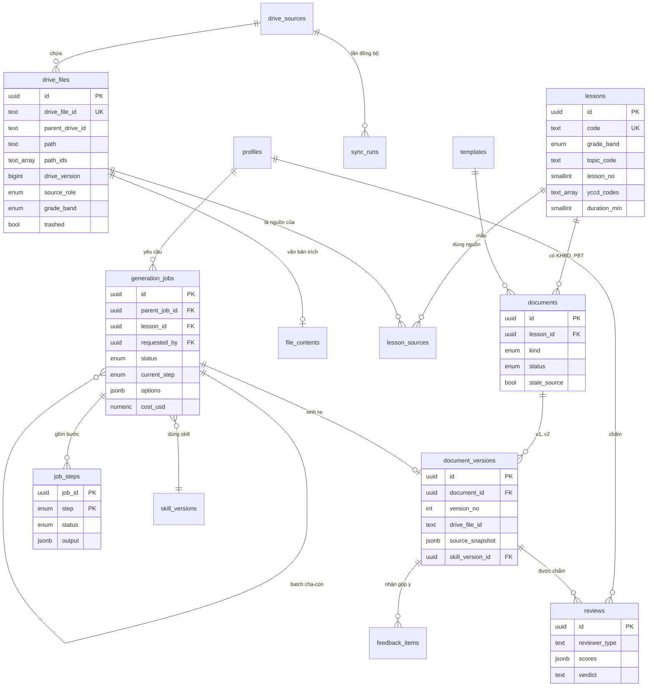
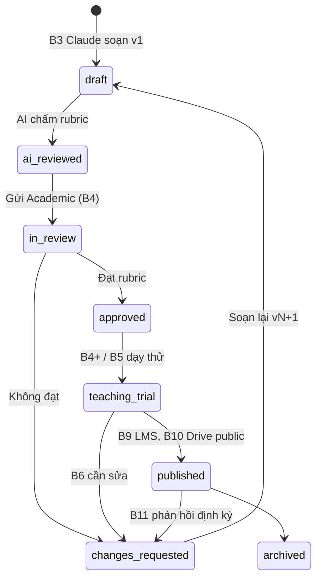
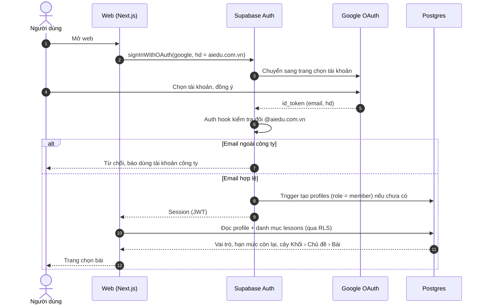
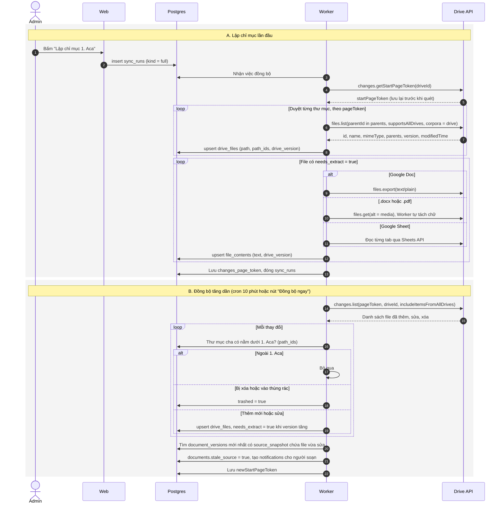
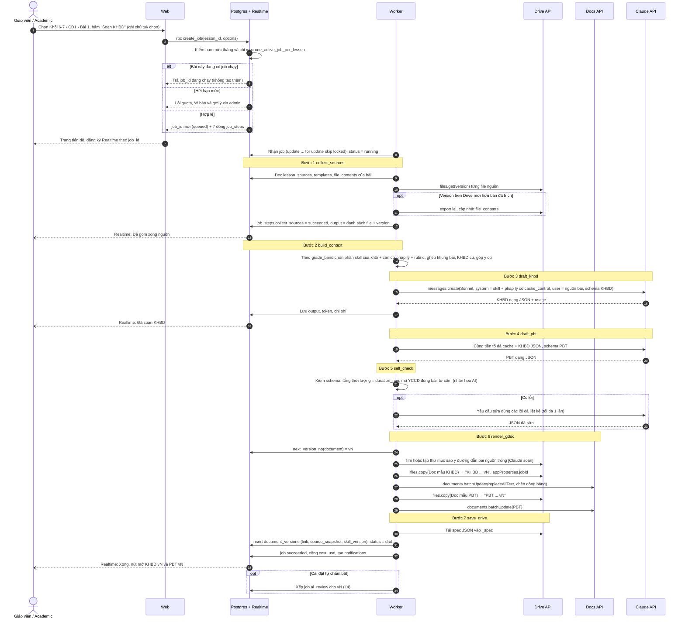
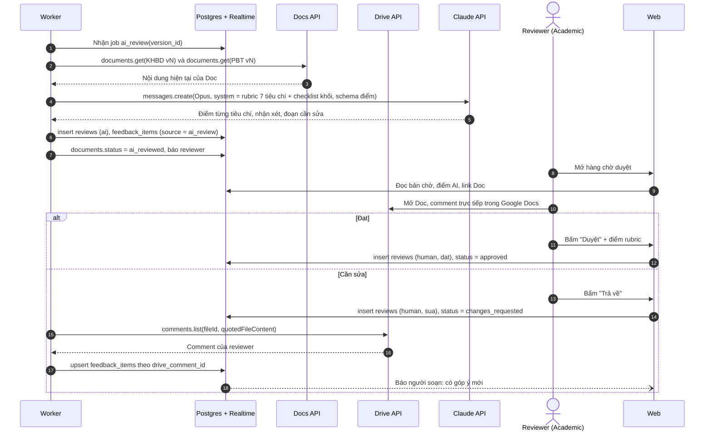
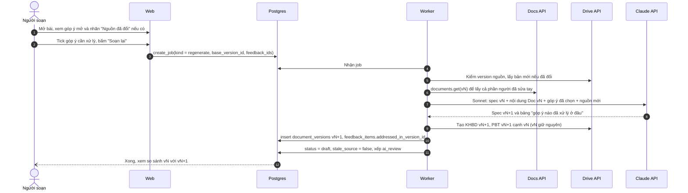
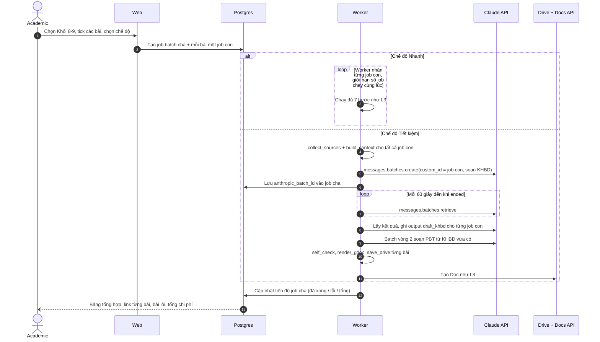
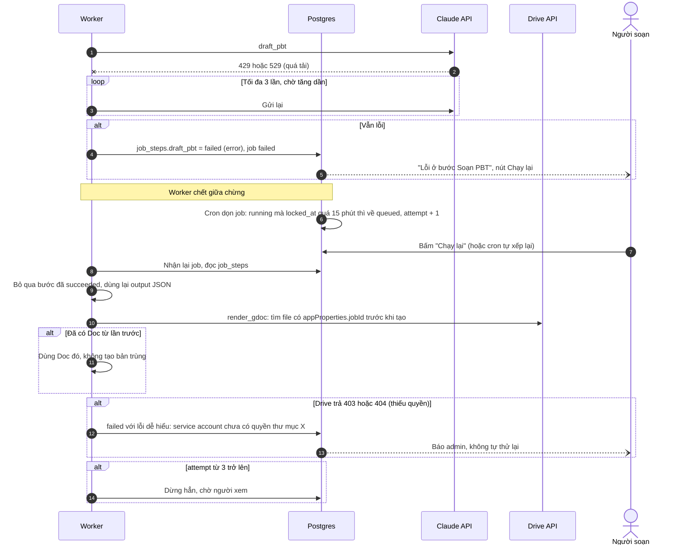

# Web KHBD 1-click — Thiết kế Database & Sequence Diagram

> **Tài liệu lịch sử (10/11/2026).** Giữ lại để hiểu bối cảnh. Nơi lưu đầu ra (`2. Testing`), DDL (`grade_band`, 18 bảng) và quy trình 7 bước ở đây **đã cũ**. Chuẩn hiện hành: `supabase/migrations/0001_init.sql` và `CLAUDE.md` (lưu vào `AI Agent`, pipeline 6 bước, skill v6).

Viết ngày 10/11/2026

## Tóm tắt

Người trong team chọn Khối → Chủ đề → Bài rồi bấm **Soạn KHBD**; web tự gom nguồn từ Drive chung, gọi Claude theo skill aca-khbd-ai12, và lưu cặp KHBD + PBT thành Google Doc vào 2. Testing › \[Claude soạn\], đúng như cách đang làm trong chat.

Năm quyết định thiết kế:

1. **Drive chung là nguồn sự thật.** Database không chép học liệu thay Drive. Nó chỉ giữ chỉ mục (metadata, đường dẫn, văn bản trích ra, mốc phiên bản file) để tra nhanh và biết nguồn nào đã đổi.
2. **Đầu ra vẫn nằm trên Drive.** Web giữ nguyên quy ước đã chốt: sao y đường dẫn bài nguồn, phiên bản v1, v2…, cặp KHBD + PBT, spec JSON trong thư mục con `_spec`.
3. **Soạn bài chạy nền theo từng bước.** Mỗi bước (gom nguồn → soạn KHBD → soạn PBT → tự kiểm → tạo Doc → lưu Drive) ghi JSON đầu ra vào database, nên lỗi ở bước nào thì chạy lại từ bước đó. Đây chính là pipeline trưởng nhóm sản phẩm đã duyệt cho bản thử, chỉ chuyển sang web.
4. **Claude không tự ghi Drive.** Skill chạy qua API nằm trong container không có mạng, nên Claude chỉ trả về JSON; worker của web mới là bên tạo Google Doc và lưu Drive.
5. **Một tài khoản dịch vụ (service account) giữ quyền Drive.** Chỉ đọc 1. Aca, chỉ ghi 2. Testing. Người dùng đăng nhập bằng Google @aiedu.com.vn, không cần tài khoản Claude.

Câu hỏi mở: bản thử đã chốt phương án A (Apps Script + Claude API). Web này là bước kế tiếp hay thay phương án A? Cần trưởng nhóm sản phẩm xác nhận trước khi dựng.

## Kiến trúc tổng thể

Sáu thành phần, và chỉ Worker chạm vào Claude và Google; trình duyệt chỉ nói chuyện với Web và Supabase.

&#91;embedded content: kiến trúc · 6 thành phần, Drive chung là nguồn\]

Người dùng mở Doc để đọc và comment ngay trên Drive chung bằng quyền sẵn có của họ; web không dựng trình soạn thảo riêng.

| Thành phần | Công nghệ đề xuất | Vai trò |
| --- | --- | --- |
| Web | Next.js (App Router), triển khai Vercel | Giao diện chọn bài, tiến độ, duyệt, chi phí |
| Supabase | Postgres + Auth + Realtime | Chỉ mục Drive, hàng đợi job, phiên bản, điểm rubric |
| Worker | Node.js trên Cloud Run | Chạy các bước soạn, đồng bộ Drive, gọi Claude |
| Claude API | Sonnet soạn, Opus chấm | Trả KHBD, PBT, điểm dạng JSON |
| Google | Drive, Docs, Sheets API qua service account | Đọc 1. Aca, tạo Doc trong 2. Testing, đọc comment và form |

## Thiết kế Database

Dùng **Supabase (PostgreSQL)**: có sẵn đăng nhập Google, phân quyền theo dòng (RLS), Realtime để đẩy tiến độ soạn bài lên màn hình, và pgvector khi cần tìm theo ngữ nghĩa. 18 bảng chia 6 nhóm; Drive vẫn là bản gốc, database là chỉ mục và nhật ký.

| Nhóm | Bảng | Giữ gì |
| --- | --- | --- |
| Người dùng | `profiles` | Email @aiedu.com.vn, vai trò (member, academic, reviewer, admin), hạn mức bài/tháng |
| Kho Drive (bản chỉ mục) | `drive_sources`, `drive_files`, `file_contents`, `sync_runs` | Cây thư mục 1. Aca, đường dẫn, số phiên bản Drive của từng file, văn bản đã trích, mốc đồng bộ (page token) |
| Chương trình | `lessons`, `lesson_sources`, `templates` | Danh mục bài theo QĐ 2422 (khối, chủ đề, bài, tiết, mã YCCĐ), bài nào dùng file nguồn nào, Doc mẫu trống theo khối |
| Sinh bài | `skill_versions`, `generation_jobs`, `job_steps` | Phiên bản skill aca-khbd-ai12, hàng đợi job, JSON đầu ra từng bước (điểm chạy tiếp), token và chi phí |
| Đầu ra & duyệt | `documents`, `document_versions`, `reviews`, `feedback_items` | KHBD/PBT của từng bài, v1/v2 kèm link Doc, ảnh chụp nguồn đã dùng, điểm rubric 7 tiêu chí, góp ý (comment Doc, form dạy thử) |
| Vận hành | `notifications`, `audit_log`, `app_settings` | Thông báo, ai làm gì lúc nào, ngân sách tháng |

### Sơ đồ quan hệ (ERD)



### DDL (đưa thẳng cho Claude Code làm migration đầu tiên)

```sql
create extension if not exists pgcrypto;
create extension if not exists pg_trgm;
-- create extension if not exists vector;  -- giai đoạn 2

create type user_role  as enum ('member','academic','reviewer','admin');
create type grade_band as enum ('TH_4','TH_5','THCS_6_7','THCS_8_9','THPT_10','THPT_11','THPT_12');
create type source_role as enum ('khung_bai','khbd_tham_khao','gop_y','phap_ly','rubric','khac');
create type doc_kind   as enum ('khbd','pbt','slide');
create type doc_status as enum ('draft','ai_reviewed','in_review','changes_requested',
                                'approved','teaching_trial','published','archived');
create type job_status as enum ('queued','running','succeeded','failed','canceled');
create type step_name  as enum ('collect_sources','build_context','draft_khbd','draft_pbt',
                                'self_check','render_gdoc','save_drive','ai_review');

-- 1. Người dùng
create table profiles (
  id            uuid primary key references auth.users on delete cascade,
  email         text unique not null check (email like '%@aiedu.com.vn'),
  full_name     text,
  role          user_role not null default 'member',
  monthly_quota int not null default 40,
  created_at    timestamptz not null default now()
);

-- 2. Kho Drive (chỉ mục, không thay Drive)
create table drive_sources (
  id                 uuid primary key default gen_random_uuid(),
  name               text not null,          -- '1. Aca'
  shared_drive_id    text not null,          -- AIE Product Shared Drive
  root_folder_id     text not null,          -- thư mục 1. Aca
  output_folder_id   text not null,          -- 2. Testing › [Claude soạn]
  changes_page_token text,                   -- mốc cho Drive changes.list
  last_synced_at     timestamptz
);

create table drive_files (
  id              uuid primary key default gen_random_uuid(),
  source_id       uuid not null references drive_sources,
  drive_file_id   text not null unique,
  parent_drive_id text,
  name            text not null,
  mime_type       text not null,
  is_folder       boolean not null default false,
  path            text not null,             -- '1. Dự án/AI 12 tiết/năm/...'
  path_ids        text[] not null,           -- id các thư mục tổ tiên
  drive_version   bigint,                    -- trường version của Drive, tăng mỗi lần sửa
  modified_time   timestamptz,
  web_view_link   text,
  source_role     source_role,               -- tự phân loại, Academic sửa tay được
  grade_band      grade_band,
  trashed         boolean not null default false,
  needs_extract   boolean not null default true,
  updated_at      timestamptz not null default now()
);
create index drive_files_path_ids on drive_files using gin (path_ids);
create index drive_files_kind on drive_files (grade_band, source_role) where not trashed;
create index drive_files_name on drive_files using gin (name gin_trgm_ops);

create table file_contents (
  file_id        uuid primary key references drive_files on delete cascade,
  drive_version  bigint not null,            -- phiên bản đã trích
  text           text not null,
  token_estimate int,
  tsv            tsvector generated always as (to_tsvector('simple', text)) stored,
  extracted_at   timestamptz not null default now()
);
create index file_contents_tsv on file_contents using gin (tsv);

create table sync_runs (
  id           uuid primary key default gen_random_uuid(),
  source_id    uuid not null references drive_sources,
  kind         text not null check (kind in ('full','incremental','manual')),
  started_at   timestamptz not null default now(),
  finished_at  timestamptz,
  added int default 0, updated int default 0, removed int default 0,
  error        jsonb
);

-- 3. Chương trình
create table lessons (
  id                     uuid primary key default gen_random_uuid(),
  code                   text unique not null,      -- vd 'L6-7_CD1_B1'
  grade_band             grade_band not null,
  topic_code             text not null,
  topic_name             text not null,
  lesson_no              smallint not null,
  period_no              smallint,                  -- tiết thứ mấy trong 12 tiết
  title                  text not null,
  yccd_codes             text[] not null default '{}',  -- vd {'6.C2.1'}
  duration_min           smallint not null,         -- 35 tiểu học, 45 THCS/THPT
  source_folder_drive_id text,                      -- thư mục bài nguồn trong 1. Aca
  active                 boolean not null default true
);

create table lesson_sources (
  lesson_id uuid references lessons on delete cascade,
  file_id   uuid references drive_files on delete cascade,
  role      source_role not null,
  priority  smallint not null default 0,
  primary key (lesson_id, file_id)
);

create table templates (
  id            uuid primary key default gen_random_uuid(),
  grade_band    grade_band not null,
  kind          doc_kind not null,
  drive_file_id text not null,                      -- Google Doc mẫu trống
  version       text not null,
  active        boolean not null default true,
  unique (grade_band, kind, version)
);

-- 4. Sinh bài
create table skill_versions (
  id                 uuid primary key default gen_random_uuid(),
  skill_name         text not null,                 -- 'aca-khbd-ai12'
  version            text not null,                 -- 'v3'
  content_hash       text not null,
  bundle_path        text not null,                 -- Storage: SKILL.md + references
  anthropic_skill_id text,                          -- nếu tải lên Skills API
  changelog          text,
  approved_by        uuid references profiles,
  is_active          boolean not null default false,
  unique (skill_name, version)
);

create table documents (
  id                     uuid primary key default gen_random_uuid(),
  lesson_id              uuid not null references lessons,
  kind                   doc_kind not null,
  template_id            uuid references templates,
  status                 doc_status not null default 'draft',
  output_folder_drive_id text,                      -- thư mục bài trong [Claude soạn]
  current_version_id     uuid,
  stale_source           boolean not null default false,  -- nguồn đã đổi sau bản mới nhất
  unique (lesson_id, kind)
);

create table generation_jobs (
  id                uuid primary key default gen_random_uuid(),
  parent_job_id     uuid references generation_jobs,  -- job batch cha
  lesson_id         uuid references lessons,
  requested_by      uuid not null references profiles,
  kind              text not null check (kind in ('khbd_pbt','regenerate','ai_review','batch')),
  status            job_status not null default 'queued',
  current_step      step_name,
  skill_version_id  uuid references skill_versions,
  model_draft       text,
  model_review      text,
  options           jsonb not null default '{}',   -- ghi chú, base_version_id, feedback_ids
  attempt           smallint not null default 0,
  locked_by         text,
  locked_at         timestamptz,
  anthropic_batch_id text,
  error             jsonb,
  input_tokens      int not null default 0,
  output_tokens     int not null default 0,
  cache_read_tokens int not null default 0,
  cost_usd          numeric(10,4) not null default 0,
  created_at        timestamptz not null default now(),
  started_at        timestamptz,
  finished_at       timestamptz
);
-- chống bấm hai lần: mỗi bài chỉ một job đang chờ/chạy cùng loại
create unique index one_active_job_per_lesson on generation_jobs (lesson_id, kind)
  where status in ('queued','running') and kind <> 'batch';
create index jobs_queue on generation_jobs (created_at) where status = 'queued';

create table job_steps (
  job_id      uuid references generation_jobs on delete cascade,
  step        step_name not null,
  status      job_status not null default 'queued',
  output      jsonb,          -- điểm chạy tiếp khi lỗi
  error       jsonb,
  tokens      jsonb,
  started_at  timestamptz,
  finished_at timestamptz,
  primary key (job_id, step)
);

-- 5. Đầu ra & duyệt
create table document_versions (
  id                 uuid primary key default gen_random_uuid(),
  document_id        uuid not null references documents on delete cascade,
  version_no         int not null,
  job_id             uuid references generation_jobs,
  drive_file_id      text not null,
  web_view_link      text not null,
  spec_drive_file_id text,                -- JSON trong _spec
  spec               jsonb,
  source_snapshot    jsonb not null,      -- [{drive_file_id, drive_version}]
  skill_version_id   uuid references skill_versions,
  created_by         uuid references profiles,
  created_at         timestamptz not null default now(),
  unique (document_id, version_no)
);
alter table documents add foreign key (current_version_id) references document_versions;

create table reviews (
  id                  uuid primary key default gen_random_uuid(),
  document_version_id uuid not null references document_versions on delete cascade,
  reviewer_type       text not null check (reviewer_type in ('ai','human')),
  reviewer_id         uuid references profiles,
  rubric_version      text not null,
  scores              jsonb not null,     -- 7 tiêu chí: {"tc1": 3, ...}
  total               numeric(4,1),
  verdict             text check (verdict in ('dat','sua','khong_dat')),
  summary             text,
  created_at          timestamptz not null default now()
);

create table feedback_items (
  id                      uuid primary key default gen_random_uuid(),
  document_version_id     uuid not null references document_versions on delete cascade,
  source                  text not null check (source in ('gdoc_comment','web','form_day_thu','ai_review')),
  drive_comment_id        text unique,
  author                  text,
  quoted_text             text,
  content                 text not null,
  criterion               text,
  status                  text not null default 'open' check (status in ('open','da_xu_ly','bo_qua')),
  addressed_in_version_id uuid references document_versions,
  created_at              timestamptz not null default now()
);

create table notifications (
  id uuid primary key default gen_random_uuid(),
  user_id uuid not null references profiles,
  type text not null, payload jsonb not null,
  read_at timestamptz, created_at timestamptz not null default now()
);
create table audit_log (
  id bigserial primary key, actor_id uuid references profiles,
  action text not null, entity text not null, entity_id text,
  meta jsonb, at timestamptz not null default now()
);
create table app_settings (key text primary key, value jsonb not null);

-- cấp số phiên bản an toàn khi hai người cùng soạn lại
create function next_version_no(doc uuid) returns int language plpgsql as $$
declare n int;
begin
  perform 1 from documents where id = doc for update;
  select coalesce(max(version_no), 0) + 1 into n from document_versions where document_id = doc;
  return n;
end $$;
```

### Phân quyền (RLS)

| Vai trò | Được làm |
| --- | --- |
| member | Xem danh mục bài và mọi bản soạn; tạo job trong hạn mức tháng; thêm góp ý |
| academic | Như member + sửa danh mục bài, gán nguồn cho bài, chạy hàng loạt |
| reviewer | Như member + chấm rubric, duyệt hoặc trả về |
| admin | Tất cả + bật phiên bản skill, sửa ngân sách, xem chi phí |

Worker dùng khóa `service_role` nên bỏ qua RLS; trình duyệt chỉ cầm khóa `anon`. Khóa Claude API và khóa service account Google chỉ nằm ở worker.

### Vòng đời một bản KHBD

Trạng thái `documents.status` bám theo quy trình B3–B10 của công ty.



## Sequence diagram các luồng

Bảy luồng dưới đây dùng chung một bộ vai: **Người dùng** (trình duyệt), **Web** (Next.js), **Auth** và **DB** (Supabase), **Worker** (tiến trình nền Node.js), **Drive** và **Docs** (Google API qua service account), **Claude** (Claude API). Chỉ Worker cầm khóa Claude và khóa Google.

### L1. Đăng nhập bằng Google công ty



Tham số `hd` chỉ là gợi ý cho Google; chặn thật nằm ở bước 6 và ở ràng buộc `check` của bảng `profiles`.

### L2. Đồng bộ kho tài liệu từ Drive chung

Lần đầu quét toàn bộ 1. Aca; sau đó cứ 10 phút hỏi Drive "có gì đổi từ mốc trước" bằng `changes.list`, nên không phải quét lại hàng nghìn file.



Người soạn thấy nhãn "Nguồn đã đổi" trên bài, bấm vào để xem file nào đổi và chọn soạn lại (L5).

### L3. Một click → KHBD + PBT (luồng chính)



Mỗi bước ghi `job_steps.output` trước khi sang bước sau, nên Realtime báo được tiến độ và L7 chạy tiếp được. `appProperties.jobId` trên file Drive giúp lần chạy lại tìm thấy Doc đã tạo, không sinh bản trùng.

### L4. Chấm rubric độc lập và duyệt (B4)

AI chấm bằng một lượt gọi mới, không mang theo hội thoại soạn bài, đọc đúng nội dung Doc hiện tại (kể cả phần người đã sửa tay). Người duyệt của Academic ra quyết định cuối.



### L5. Soạn lại phiên bản mới theo góp ý



### L6. Soạn hàng loạt cả chủ đề hoặc cả khối

Hai chế độ: **Nhanh** chạy qua hàng đợi thường, giới hạn vài bài song song; **Tiết kiệm** dùng Message Batches API, giá bằng 50% nhưng có thể mất tới 24 giờ.



KHBD và PBT phải chạy hai vòng batch vì PBT dựa vào KHBD. Bài nào lỗi chỉ chạy lại bài đó (L7).

### L7. Lỗi giữa chừng và chạy tiếp



## Use case thực tế

Mười tình huống team sẽ gặp, mỗi dòng chỉ ra luồng nào ở trên xử lý nó.

| # | Tình huống | Ai | Bước quy trình | Luồng | Kết quả trên web |
| --- | --- | --- | --- | --- | --- |
| UC1 | Cần gấp KHBD tiết 6 lớp 5 để dạy thử tuần sau | Giáo viên, Academic | B3 | L1, L3 | Hai link Doc v1 (KHBD, PBT) trong 2. Testing › \[Claude soạn\], không cần tài khoản Claude |
| UC2 | Rà bản AI vừa soạn theo rubric 7 tiêu chí | Reviewer Academic | B4 | L4 | Điểm AI có sẵn, reviewer comment trong Doc rồi bấm Duyệt hoặc Trả về |
| UC3 | Bị trả về, sửa theo comment | Người soạn | B4 → B3 | L5 | v2 nằm cạnh v1, comment nào đã xử lý được đánh dấu |
| UC4 | Đầu học kỳ cần đủ bài của khối 8&9 | Academic | B3 hàng loạt | L6 | Bảng tiến độ từng bài, tổng chi phí, chỉ chạy lại bài lỗi |
| UC5 | Academic sửa khung bài trong 1. Aca sau khi đã có KHBD | Academic, người soạn | B2 → B3 | L2-B, L5 | Nhãn "Nguồn đã đổi" trên mọi bài dùng khung cũ, kèm thông báo |
| UC6 | GV dạy thử xong, điền form phản hồi | Giáo viên dạy thử | B5 → B6 | L5 (nguồn góp ý = form) | Worker đọc Sheet câu trả lời của form, ghi `feedback_items` nguồn `form_day_thu`, dùng cho v kế tiếp |
| UC7 | Team khác (Delivery, IS) cần học liệu mà không dùng tài khoản Claude | Mọi người @aiedu.com.vn | B3 | L1, L3 | Đúng yêu cầu công cụ sản xuất hàng loạt của trưởng nhóm sản phẩm |
| UC8 | Nâng skill aca-khbd-ai12 lên bản mới | Admin, Academic duyệt | B6 | — | Bật `skill_versions.is_active`; mọi bản soạn ghi phiên bản skill đã dùng, so được điểm rubric trung bình giữa hai bản skill |
| UC9 | Claude quá tải hoặc service account thiếu quyền | Hệ thống | — | L7 | Tự thử lại lỗi tạm thời; lỗi quyền báo thẳng admin bằng lời dễ hiểu |
| UC10 | Xem đã tiêu bao nhiêu trong tháng, ai dùng nhiều | Admin, team lead | — | — | Tổng `cost_usd` theo người, khối, phiên bản skill; chặn tạo job khi vượt ngân sách tháng |

Các bước còn lại của quy trình: B1 là nạp danh mục vào `lessons`; B7–B8 (slide) đã có chỗ trong `doc_kind = slide` nhưng để giai đoạn 2; B9–B10 (LMS, Drive public) nằm ngoài web, web chỉ ghi trạng thái `published` và link.

## Lộ trình dựng bằng Claude Code

Làm MVP cho đúng một bài đã thử trong chat trước, so kết quả với bản chat, rồi mới mở duyệt và hàng loạt.

### Việc cần chuẩn bị trước khi code

- [ ] Anh Thái Minh xác nhận web là bước kế tiếp hay thay phương án A (Apps Script)
- [ ] Tạo Google Cloud project, bật Drive API, Docs API, Sheets API, tạo service account
- [ ] Owner của AIE Product Shared Drive thêm service account: quyền Viewer ở 1. Aca, Content manager ở 2. Testing (nếu Workspace chặn chia sẻ ra ngoài domain thì cần admin mở cho địa chỉ này)
- [ ] Tạo project Supabase, bật đăng nhập Google
- [ ] Khóa Claude API riêng cho web, đặt giới hạn chi tiêu của workspace trong Console
- [ ] Academic chốt danh mục bài (B1) thành một Sheet để nạp `lessons`, và mỗi khối một Doc mẫu trống KHBD, PBT

### Các giai đoạn

1. **MVP một bài.** Next.js + Supabase, chạy DDL ở trên làm migration đầu, L2-A lập chỉ mục 1. Aca (đối chiếu số file với Drive), L1 đăng nhập, L3 cho một bài, trang tiến độ Realtime.
2. **Vòng duyệt.** L4 chấm rubric và hàng chờ duyệt, L5 soạn lại theo góp ý, L2-B đồng bộ tăng dần và nhãn "Nguồn đã đổi", thông báo.
3. **Hàng loạt và vận hành.** L6 hai chế độ, L7 dọn job kẹt, trang chi phí, quản lý phiên bản skill, đọc form dạy thử; sau đó mới tới slide (B7).

### Ba lưu ý kỹ thuật

- **Worker cần tiến trình chạy lâu.** Một bài gọi Claude nhiều lượt, nên đặt Worker ở Cloud Run (cùng project với service account) hoặc một máy chủ nhỏ, không nhét vào serverless function của web.
- **Nạp skill.** Giai đoạn 1 đọc SKILL.md và tài liệu của khối làm system prompt có prompt caching, yêu cầu trả JSON theo schema: dễ kiểm soát và rẻ. Tải skill lên Skills API chỉ đáng khi cần Claude chạy script trong container; container đó không có mạng, nên phần lưu Drive của skill vẫn do Worker làm.
- **Chi phí.** Prompt caching cho phần skill + pháp lý lặp lại ở mọi bài; batch giảm 50% cho soạn hàng loạt. Mỗi job đã ghi token và `cost_usd`, nên chạy MVP một bài là có số thật để đề xuất ngân sách API.

### Câu lệnh khởi động cho Claude Code

```text
Đọc tài liệu thiết kế "Web KHBD 1-click" (đính kèm). Dựng giai đoạn 1:
1. Khởi tạo monorepo: apps/web (Next.js App Router), apps/worker (Node.js), packages/db.
2. Tạo migration từ mục DDL, sinh TypeScript types, viết RLS theo bảng phân quyền.
3. Worker: lập chỉ mục thư mục 1. Aca theo luồng L2-A, in tổng số file và số file không trích được.
4. Worker: luồng L3 đủ 7 bước, mỗi bước ghi job_steps.output, Doc tạo bằng files.copy + documents.batchUpdate.
5. Web: đăng nhập Google chỉ @aiedu.com.vn, trang chọn bài, trang tiến độ dùng Supabase Realtime.
Không ghi gì ra ngoài 2. Testing. Hỏi tôi trước khi đổi schema.
```

### Tham khảo

- [Using Agent Skills with the API](https://platform.claude.com/docs/en/build-with-claude/skills-guide)
- [Batch processing](https://platform.claude.com/docs/en/build-with-claude/batch-processing.md)
- [Agent Skills overview](https://platform.claude.com/docs/en/agents-and-tools/agent-skills/overview?facet1=crm)
