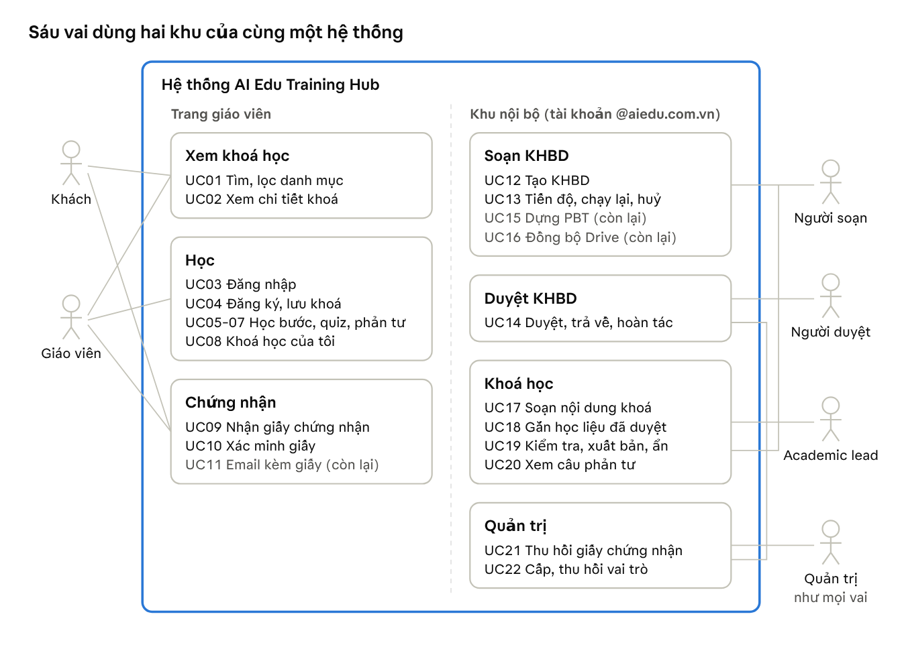
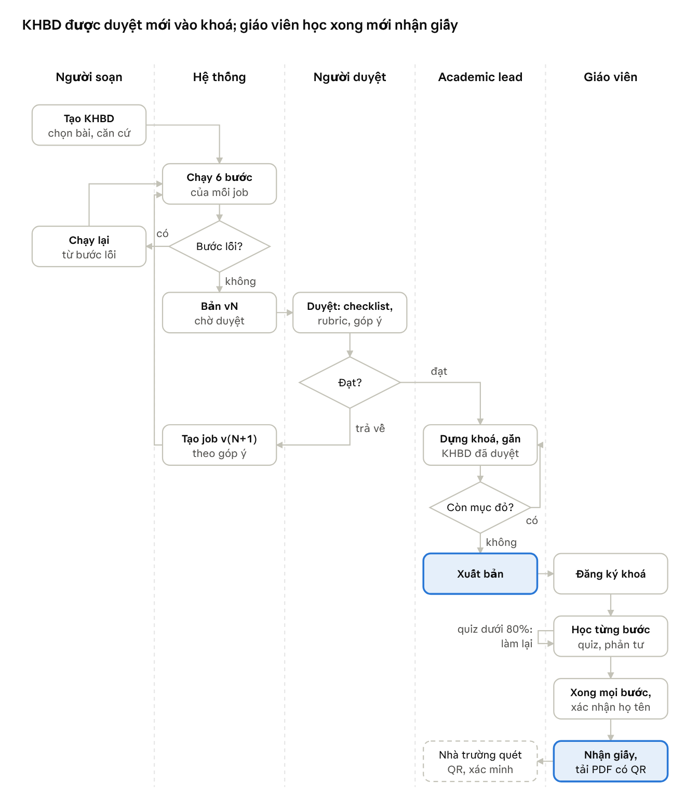
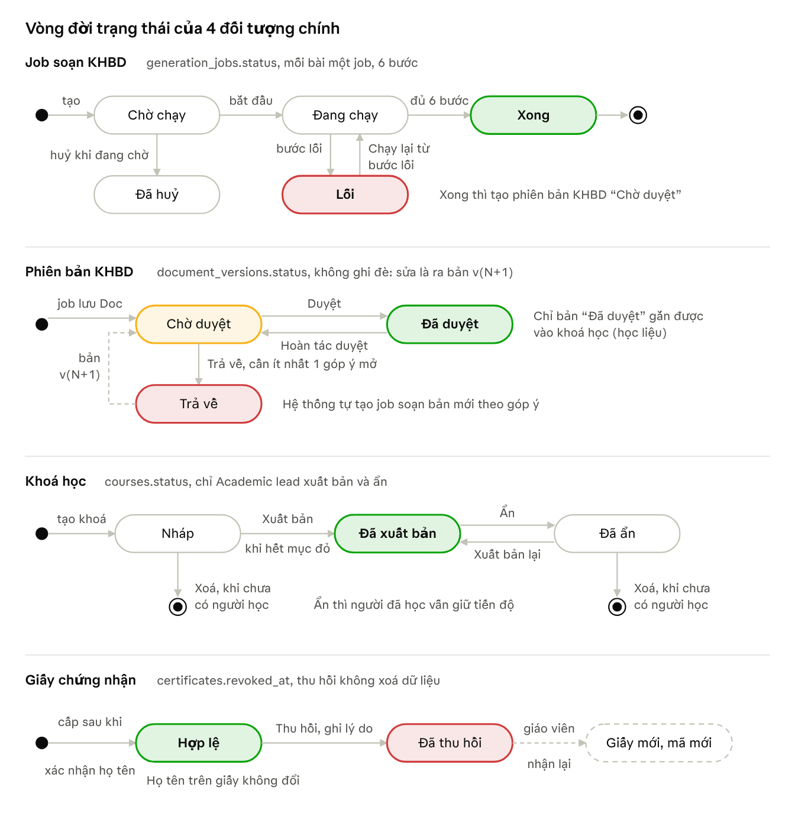
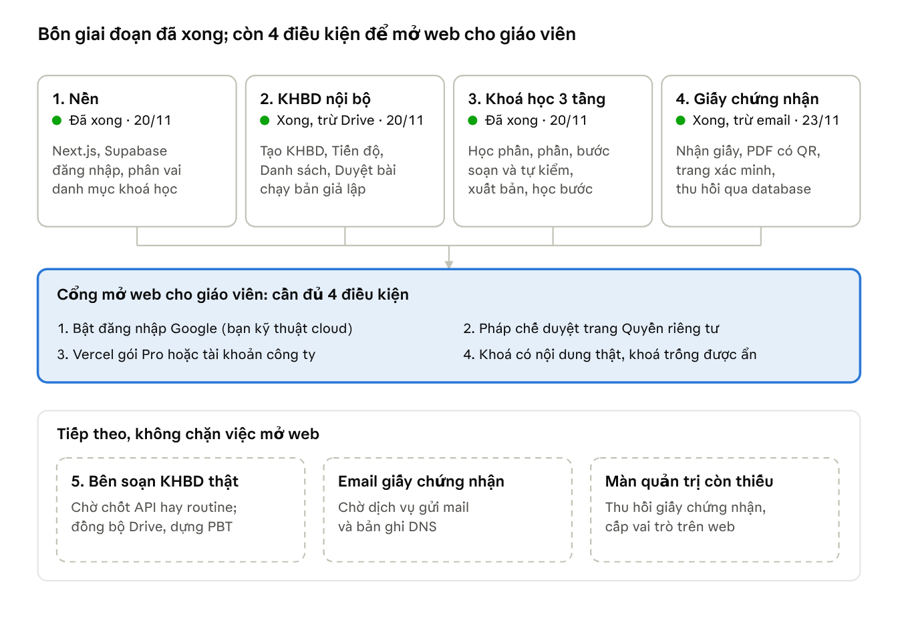
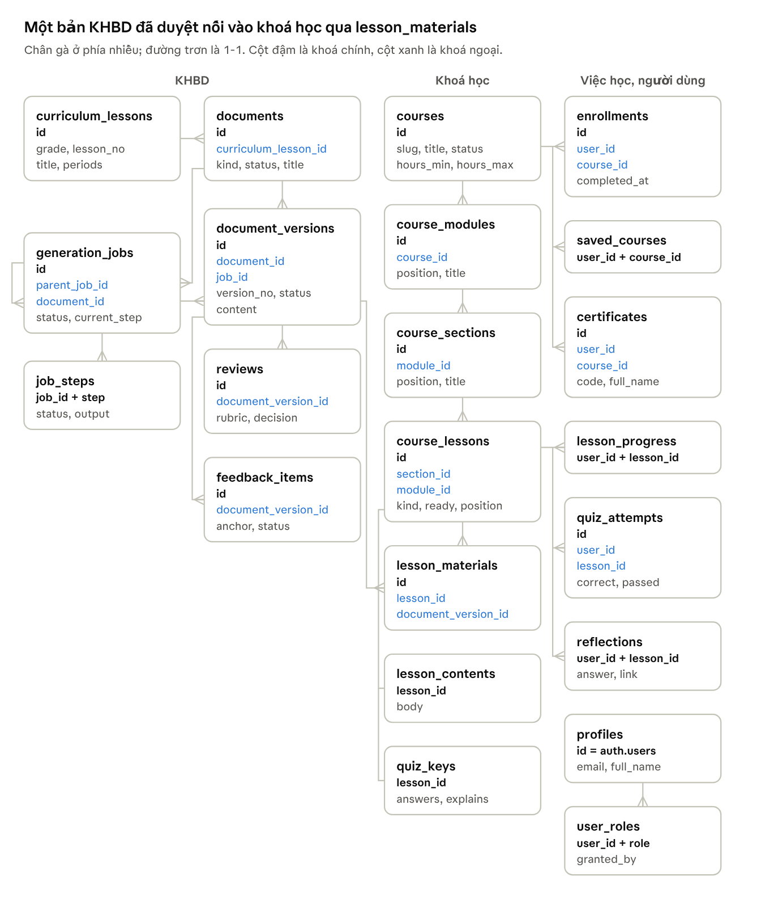

# PRD và Use case – AI Edu Training Hub

Cập nhật 26/11/2026 · Midu. Bản gốc (sửa ở đây trước, rồi xuất lại vào repo): [Claude Doc](https://claude.ai/artifact/1KrTz75tBfchTS6Zk5od1A).

## 1. Tổng quan

AI Edu Training Hub là web giáo dục gồm hai khu trên cùng một database: trang giáo viên học khoá đào tạo về AI và nhận giấy chứng nhận, khu nội bộ để nhân viên AI Edu soạn KHBD bằng AI, duyệt bài và dựng khoá học. Bản chạy thử: [aie-tool-tici.vercel.app](https://aie-tool-tici.vercel.app). Mã nguồn: [midu1405/AIE-tool](https://github.com/midu1405/AIE-tool).

**Vấn đề.** Kế hoạch bài dạy (KHBD) cho chương trình Giáo dục AI 12 tiết/năm (QĐ 2422, CV 5588) đang soạn thủ công trên Drive, theo dõi tiến độ bằng tay, khó biết bài nào đang ở bước nào. Giáo viên chưa có một nơi học cách dạy AI theo lộ trình rõ ràng, có kiểm tra và xác nhận hoàn thành.

**Mục tiêu.**

- Nhân viên tạo KHBD hàng loạt bằng skill `aca-khbd-ai12`, theo dõi 6 bước của từng bài và duyệt theo checklist 2422/5588 cùng rubric 7 tiêu chí trên một màn hình.

- Academic dựng khoá học 3 tầng (Học phần → Phần → Bước), gắn KHBD/PBT đã duyệt làm học liệu, tự kiểm rồi xuất bản.

- Giáo viên tìm khoá, học từng bước, làm quiz, viết phản tư, nhận giấy chứng nhận có mã QR xác minh.

**Trong phạm vi bản này:** danh mục và chi tiết khoá, học từng bước, Khoá học của tôi, giấy chứng nhận, khu nội bộ (Tạo KHBD, Tiến độ, Danh sách KHBD, Duyệt bài, Quản lý và Soạn nội dung khoá), phân quyền theo vai trò.

**Ngoài phạm vi bản này:** chấm điểm hay quản lý lớp học sinh, thanh toán, diễn đàn thảo luận, ứng dụng di động riêng, LMS bên ngoài. Học sinh không có tài khoản trên web.

## 2. Người dùng và vai trò

Có 5 vai, một người giữ được nhiều vai. Chỉ tài khoản `@aiedu.com.vn` được giữ vai nhân viên; quyền kiểm ở database (RLS), giao diện chỉ ẩn nút.

| Vai (mã trong hệ thống)           | Là ai                              | Cần gì                                                                    | Được làm                                                                                                          |
|-----------------------------------|------------------------------------|---------------------------------------------------------------------------|-------------------------------------------------------------------------------------------------------------------|
| Giáo viên (không có vai)          | Giáo viên, cán bộ quản lý giáo dục | Học cách dạy AI theo lộ trình ngắn, học trên điện thoại, có giấy xác nhận | Xem khoá đã xuất bản, đăng ký, học từng bước, làm quiz, viết phản tư, lưu khoá, mở học liệu, nhận giấy chứng nhận |
| Người soạn KHBD (`khbd_editor`)   | Nhân viên Academic                 | Tạo nhiều KHBD một lượt, biết bài nào lỗi để chạy lại                     | Tạo job KHBD, chạy lại, huỷ; tạo và sửa khoá nháp                                                                 |
| Người duyệt (`reviewer`)          | Nhân viên Academic                 | Duyệt nhanh theo checklist chung, góp ý đúng chỗ                          | Duyệt hoặc trả về KHBD, hoàn tác duyệt                                                                            |
| Academic lead (`content_manager`) | Trưởng nhóm nội dung               | Kiểm soát khoá nào được hiện với giáo viên                                | Mọi việc với khoá học (gồm xuất bản, ẩn), duyệt KHBD, thu hồi giấy chứng nhận                                     |
| Quản trị (`admin`)                | Người vận hành hệ thống            | Cấp quyền, xử lý sự cố                                                    | Như mọi vai; cấp và thu hồi vai trò                                                                               |

Người xem chưa đăng nhập xem được danh mục, chi tiết khoá, trang trợ giúp và trang xác minh giấy chứng nhận.

## 3. Danh sách use case

22 use case: 14 đã chạy trên web, 5 mới làm một phần, 3 còn lại. “Một phần” ghi rõ phần thiếu ở cột Ghi chú.

| Mã   | Use case                                | Tác nhân                   | Trạng thái | Ghi chú                                                  |
|------|-----------------------------------------|----------------------------|------------|----------------------------------------------------------|
| UC01 | Tìm và lọc danh mục khoá học            | Khách, giáo viên           | Đã có      | Tìm bỏ dấu; lọc đối tượng, chủ đề, thời lượng, hình thức |
| UC02 | Xem chi tiết khoá                       | Khách, giáo viên           | Đã có      | Nội dung 3 tầng, cần có, cần chuẩn bị                    |
| UC03 | Đăng nhập                               | Giáo viên, nhân viên       | Một phần   | Google chưa bật; nhân viên tạm dùng email + mật khẩu     |
| UC04 | Đăng ký và lưu khoá                     | Giáo viên                  | Đã có      |                                                          |
| UC05 | Học một bước (bài đọc, video, tổng kết) | Giáo viên                  | Đã có      | Đánh dấu đã xong, bước trước/sau                         |
| UC06 | Làm quiz                                | Giáo viên                  | Đã có      | Đạt khi đúng ≥ 80% số câu, làm lại không giới hạn        |
| UC07 | Viết phản tư, nộp sản phẩm              | Giáo viên                  | Đã có      |                                                          |
| UC08 | Theo dõi Khoá học của tôi               | Giáo viên                  | Đã có      | Đang học, Đã hoàn thành, Đã lưu                          |
| UC09 | Nhận giấy chứng nhận                    | Giáo viên                  | Đã có      | Xác nhận họ tên, tải PDF                                 |
| UC10 | Xác minh giấy chứng nhận                | Khách, nhà trường          | Đã có      | Quét QR hoặc nhập mã                                     |
| UC11 | Nhận email kèm giấy chứng nhận          | Giáo viên, hệ thống        | Còn lại    | Chờ dịch vụ gửi mail và DNS                              |
| UC12 | Tạo KHBD (soạn lại từ kho, bài mới)     | Người soạn                 | Một phần   | Đang chạy bản giả lập, chưa có bên soạn thật             |
| UC13 | Theo dõi tiến độ, chạy lại, huỷ job     | Người soạn                 | Một phần   | Theo bản giả lập                                         |
| UC14 | Duyệt KHBD                              | Người duyệt, Academic lead | Đã có      | Checklist, rubric 7 tiêu chí, góp ý theo phần            |
| UC15 | Dựng PBT sau khi KHBD được duyệt        | Người soạn                 | Còn lại    | Giai đoạn 2 của skill                                    |
| UC16 | Đồng bộ cây kho học liệu từ Drive       | Hệ thống                   | Còn lại    | Chờ service account Google                               |
| UC17 | Tạo và soạn nội dung khoá               | Người soạn, Academic lead  | Đã có      | Học phần → Phần → Bước                                   |
| UC18 | Gắn KHBD/PBT đã duyệt làm học liệu      | Người soạn, Academic lead  | Đã có      | “Gắn vN” khi có bản mới                                  |
| UC19 | Kiểm tra và xuất bản, ẩn khoá           | Academic lead              | Đã có      | Danh sách tự kiểm chặn khi còn mục đỏ                    |
| UC20 | Xem câu trả lời phản tư                 | Người phụ trách khoá       | Đã có      |                                                          |
| UC21 | Thu hồi giấy chứng nhận                 | Academic lead              | Một phần   | Chỉ làm được bằng lệnh database, chưa có màn             |
| UC22 | Cấp, thu hồi vai trò                    | Quản trị                   | Một phần   | Làm trong Supabase, chưa có màn trên web                 |

sơ đồ use case · 6 tác nhân, 7 nhóm use case

Khách và giáo viên chỉ dùng trang giáo viên; bốn vai nhân viên chỉ dùng khu nội bộ. Người soạn sửa được khoá nháp; xuất bản, ẩn và thu hồi giấy là việc của Academic lead.

## 4. Đặc tả use case chính

Sáu use case dưới đây quyết định giá trị sản phẩm; các use case còn lại đơn giản, xem bảng ở mục 3. Mỗi use case ghi tác nhân, điều kiện, luồng chính, ngoại lệ và kết quả.

luồng user story · 5 làn, 3 điểm quyết định, 4 vòng lặp

Có bốn vòng lặp: job lỗi thì chạy lại, KHBD trả về thì hệ thống soạn bản mới, khoá còn mục đỏ thì sửa tiếp, quiz dưới 80% thì làm lại. Khoá có thể xuất bản không cần KHBD; khi có, chỉ bản đã duyệt được gắn.

### UC12. Tạo KHBD

**Tác nhân:** người soạn KHBD. **Điều kiện:** đã đăng nhập, có vai `khbd_editor` trở lên; cây kho học liệu đã có (hiện dùng khung mẫu lớp 6).

1.  Chọn cách soạn: **soạn lại từ kho** (chọn một hoặc nhiều bài trong cây Tiểu học › THCS › THPT › Chủ đề › Bài) hoặc **bài mới** (lớp, chủ đề theo khung NLS, tên bài, số tiết, tài liệu, ý tưởng).

2.  Giữ căn cứ bắt buộc QĐ 2422, CV 5588; tuỳ chọn thêm TT 02, TT 16, TT 18, TT 85; ghi chú nếu có.

3.  Bấm tạo. Hệ thống tạo một lượt chạy, mỗi bài một job, mỗi job 6 bước: đọc bài nguồn → chọn mã 2422 → soạn KHBD + spec → kiểm tra 2422/5588 → lưu Google Doc → ghi nhật ký chạy.

4.  Chuyển sang màn Tiến độ, tự cập nhật từng bước.

**Ngoại lệ:** lớp 1–3 chưa soạn được; lớp 4–5 chưa có khung NLS nên bản soạn ghi giả định. Một bước lỗi thì job dừng ở bước đó; người soạn bấm “Chạy lại từ bước lỗi” hoặc huỷ.

**Kết quả:** mỗi bài có phiên bản KHBD trạng thái “Chờ duyệt”, Doc lưu trong `AI Agent › <ngày> › <đường dẫn bài nguồn> › Bài N`, đuôi `– vN`. Không ghi đè: sửa là ra bản mới.

### UC14. Duyệt KHBD

**Tác nhân:** người duyệt, Academic lead. **Điều kiện:** có phiên bản “Chờ duyệt”.

1.  Mở hàng chờ Duyệt bài, chọn một bài.

2.  Đọc bản xem trước theo thứ tự: I. Mục tiêu, II. Thiết bị dạy học và học liệu, III. Tiến trình dạy học.

3.  Đánh dấu checklist 2422/5588, chấm rubric 7 tiêu chí (3 mức), ghi góp ý gắn với từng phần.

4.  Chọn **Duyệt** hoặc **Trả về**.

**Quy tắc:** trả về bắt buộc có ít nhất 1 góp ý mở và tự tạo job soạn bản v(N+1) theo góp ý. Duyệt nhầm thì bấm Hoàn tác duyệt. Xem được bản cũ để so sánh.

**Kết quả:** bản “Đã duyệt” gắn được vào khoá học (UC18); bản trả về có bản kế tiếp đang soạn.

### UC17–UC19. Dựng và xuất bản khoá học

**Tác nhân:** người soạn (khoá nháp), Academic lead (mọi khoá, xuất bản). **Điều kiện:** đã đăng nhập với vai phù hợp.

1.  Tạo khoá ở màn Quản lý khoá học, điền tab Thông tin trang khoá (tóm tắt, đối tượng, chủ đề, thời lượng, cần có, cần chuẩn bị).

2.  Ở tab Nội dung, dựng cây Học phần → Phần → Bước: thêm, đổi tên, xoá, đổi thứ tự; soạn từng bước theo loại (bài đọc, video, quiz, phản tư, tổng kết) và đánh dấu “Sẵn sàng”.

3.  Gắn KHBD/PBT đã duyệt vào bước làm học liệu, ghim đúng một phiên bản.

4.  Ở tab Kiểm tra trước khi xuất bản, sửa hết mục đỏ rồi bấm **Xuất bản**.

**Quy tắc:** nút Xuất bản bị chặn khi còn mục đỏ (bước chưa sẵn sàng, quiz thiếu đáp án hoặc giải thích, video thiếu bản ghi lời…). Không bắt buộc người khác xem trước. Khoá đã xuất bản mà còn mục đỏ thì màn soạn hiện cảnh báo. Chỉ xoá được khoá chưa có người học. Khi có bản KHBD mới hơn đã duyệt, màn Quản lý hiện “Có vN đã duyệt” để người quản lý tự chọn “Gắn vN”.

**Kết quả:** khoá hiện trong danh mục cho giáo viên; ẩn khoá thì khoá biến mất khỏi danh mục nhưng người đã học vẫn giữ tiến độ.

### UC05–UC07. Học từng bước

**Tác nhân:** giáo viên. **Điều kiện:** đã đăng nhập và đăng ký khoá đang xuất bản.

1.  Mở khoá, bấm bước cần học trên mục lục (trên điện thoại mục lục thu gọn).

2.  Theo loại bước: bài đọc, video, tổng kết → bấm “Đánh dấu đã xong”; quiz → nộp bài, hệ thống chấm; phản tư → lưu câu trả lời (kèm link sản phẩm nếu có).

3.  Chuyển bước trước/sau.

**Quy tắc:** quiz chấm ở database, đạt khi đúng ít nhất 80% số câu (làm tròn lên), làm lại không giới hạn; sau khi nộp hiện câu đúng, câu sai và giải thích. Bước quiz chỉ tính xong khi đạt; bước phản tư chỉ tính xong khi đã lưu câu trả lời. Câu trả lời phản tư chỉ giáo viên đó và người phụ trách khoá xem được.

**Kết quả:** tiến độ lưu theo tài khoản; xong mọi bước thì khoá được đánh dấu “Đã hoàn thành”.

### UC09. Nhận giấy chứng nhận

**Tác nhân:** giáo viên. **Điều kiện:** đã hoàn thành mọi bước của khoá.

1.  Bấm “Nhận giấy chứng nhận” ở thẻ hoàn thành khoá hoặc tab Đã hoàn thành.

2.  Kiểm tra họ tên điền sẵn từ tài khoản, sửa cho đúng dấu và thứ tự; bản xem trước đổi theo tên đang gõ.

3.  Bấm “Cấp giấy chứng nhận”.

4.  Tải PDF, mở trang xác minh hoặc sao chép link xác minh.

**Ngoại lệ:** họ tên dưới 2 chữ hoặc quá 80 ký tự thì báo lỗi; chưa xong khoá thì trang báo còn bao nhiêu bước. Bấm cấp hai lần vẫn chỉ ra một giấy.

**Kết quả:** giấy có mã `AIE-<năm>-XXXXXX`, PDF A4 ngang có QR. Họ tên trên giấy không đổi; cần sửa thì Academic lead thu hồi (UC21) và giáo viên nhận lại với mã mới.

### UC10. Xác minh giấy chứng nhận

**Tác nhân:** bất kỳ ai có mã (nhà trường, phòng giáo dục). **Điều kiện:** không cần đăng nhập.

1.  Quét QR trên giấy hoặc nhập mã ở trang Xác minh.

2.  Trang hiện một trong ba kết quả: **Hợp lệ** (họ tên, khoá, thời lượng, ngày hoàn thành, mã, tải PDF), **Đã thu hồi** (ngày thu hồi), **Không tìm thấy**.

**Quy tắc:** không hiện email, kết quả quiz hay câu phản tư; mã sai dạng báo ngay cách sửa; giấy đã thu hồi không tải được PDF.

### Vòng đời trạng thái

Mỗi đối tượng chỉ đổi trạng thái qua thao tác có kiểm tra ở database; nhãn trên web lấy đúng các trạng thái này.

vòng đời trạng thái · job, phiên bản KHBD, khoá học, giấy chứng nhận

Job chỉ huỷ được khi đang chờ chạy. Khoá học không quay lại nháp sau khi đã xuất bản. Hai trạng thái `draft` và `archived` có trong database của phiên bản KHBD nhưng web chưa dùng.

## 5. Yêu cầu chức năng

Mỗi yêu cầu kiểm được bằng thao tác trên web hoặc test database. Cột UC chỉ về use case ở mục 3.

| Mã   | Khu              | Yêu cầu                                                                                                         | UC         |
|------|------------------|-----------------------------------------------------------------------------------------------------------------|------------|
| FR01 | Danh mục         | Chỉ hiện khoá đã xuất bản; tìm theo tên không phân biệt dấu (“hieu biet” ra “Hiểu biết”)                        | UC01       |
| FR02 | Danh mục         | Lọc theo đối tượng, chủ đề, thời lượng, hình thức; dưới 768 px các nhóm lọc gộp vào nút “Bộ lọc (n)”            | UC01       |
| FR03 | Danh mục         | Cả thẻ khoá bấm được; rê chuột hoặc Tab tới thì thẻ nổi lên, đổi màu viền                                       | UC01       |
| FR04 | Chi tiết khoá    | Hiện thông tin nhanh (thời lượng, hình thức, cấp độ, chứng nhận), cần có, cần chuẩn bị, nội dung 3 tầng         | UC02       |
| FR05 | Chi tiết khoá    | Đăng ký, lưu khoá, hiện tiến độ của người đang đăng nhập                                                        | UC04       |
| FR06 | Học bước         | 5 loại bước: bài đọc (Markdown rút gọn), video (YouTube, Drive), quiz, phản tư, tổng kết học phần               | UC05–UC07  |
| FR07 | Học bước         | Chấm quiz ở database; đạt khi đúng ≥ 80% số câu, làm tròn lên; đáp án không gửi xuống trình duyệt trước khi nộp | UC06       |
| FR08 | Học bước         | Xong mọi bước thì tự đánh dấu khoá “Đã hoàn thành”                                                              | UC05       |
| FR09 | Khoá học của tôi | Ba tab Đang học, Đã hoàn thành, Đã lưu; khoá đã xong có nút giấy chứng nhận                                     | UC08       |
| FR10 | Chứng nhận       | Xác nhận họ tên trước khi cấp; mỗi người một giấy còn hiệu lực cho mỗi khoá                                     | UC09       |
| FR11 | Chứng nhận       | PDF A4 ngang, font Be Vietnam Pro, logo AI Edu × Google for Education, mã và QR dẫn tới trang xác minh          | UC09       |
| FR12 | Chứng nhận       | Trang xác minh công khai có 3 trạng thái; thu hồi không xoá dữ liệu                                             | UC10, UC21 |
| FR13 | Chứng nhận       | Gửi email kèm PDF khi cấp (chưa làm)                                                                            | UC11       |
| FR14 | Tạo KHBD         | Tạo nhiều bài một lượt; mỗi job đúng 6 bước theo skill `aca-khbd-ai12`                                          | UC12       |
| FR15 | Tiến độ          | Cập nhật trực tiếp (Realtime); chạy lại từ bước lỗi; huỷ job                                                    | UC13       |
| FR16 | Danh sách KHBD   | Mỗi tài liệu một dòng với trạng thái đang chạy, lỗi, chờ duyệt, đã duyệt, trả về                                | UC12–UC14  |
| FR17 | Duyệt bài        | Checklist 2422/5588, rubric 7 tiêu chí, góp ý theo phần; trả về cần ≥ 1 góp ý và tự tạo bản v(N+1)              | UC14       |
| FR18 | Duyệt bài        | Xem trước KHBD theo thứ tự mục chuẩn I–III; xem bản cũ; hoàn tác duyệt                                          | UC14       |
| FR19 | Soạn khoá        | Thêm, đổi tên, xoá, đổi thứ tự học phần, phần, bước                                                             | UC17       |
| FR20 | Soạn khoá        | Chỉ gắn được KHBD/PBT đã duyệt; một bước không gắn hai phiên bản của cùng tài liệu                              | UC18       |
| FR21 | Soạn khoá        | Danh sách tự kiểm chặn Xuất bản khi còn mục đỏ; cảnh báo khi khoá đã xuất bản còn mục đỏ                        | UC19       |
| FR22 | Soạn khoá        | Xuất bản hoặc ẩn khoá thì danh mục cập nhật ngay                                                                | UC19       |
| FR23 | Soạn khoá        | Người phụ trách khoá xem câu trả lời phản tư của người học                                                      | UC20       |
| FR24 | Chung            | Trang Trợ giúp, Quyền riêng tư, Điều khoản; email hỗ trợ lấy từ cấu hình                                        | —          |

## 6. Yêu cầu phi chức năng

Quyền nằm ở database, không ở giao diện: mọi bảng bật Row Level Security, nên gọi thẳng API cũng không vượt quyền.

**Bảo mật và phân quyền**

- Mọi bảng bật RLS và có policy ngay khi tạo; trình duyệt chỉ dùng khoá công khai, khoá quản trị chỉ ở server.

- Ghi dữ liệu quan trọng qua hàm database có kiểm tra: chấm quiz, cấp và thu hồi giấy, duyệt KHBD, xuất bản khoá.

- Không viết cứng secret, ID Drive hay email trong code; không đưa token vào log hoặc commit.

- Drive: chỉ đọc kho nguồn; chỉ tạo mới trong thư mục `AI Agent`; không ghi, đổi tên, di chuyển hay xoá file nguồn.

- Bộ test quyền trên Postgres trống: hiện 30 ca “phải lỗi”, chạy trước mỗi lần merge.

**Quyền riêng tư**

- Lưu email, họ tên, tiến độ, lượt làm quiz, câu phản tư, giấy chứng nhận; chỉ cookie giữ phiên, không công cụ theo dõi.

- Giáo viên khác không xem được dữ liệu của nhau; trang xác minh chỉ hiện họ tên, khoá, thời lượng, ngày.

- Trang Quyền riêng tư phải được pháp chế duyệt trước khi bật đăng nhập Google; đổi cách lưu dữ liệu thì sửa trang này.

**Giao diện và truy cập**

- Theo đúng bản thiết kế trên canvas (14 màn): font Be Vietnam Pro, màu và bo góc theo token.

- Dùng được ở chiều rộng 390 px, không tràn ngang; vùng bấm tối thiểu 44 px.

- Tương phản chữ ≥ 4.5:1; mọi ô nhập có nhãn; dùng được bằng bàn phím; tôn trọng chế độ giảm chuyển động.

- Tiếng Việt đúng dấu; nút ghi rõ việc sẽ xảy ra; thông báo lỗi nói lỗi gì và cách sửa.

**Hiệu năng và vận hành**

- Danh mục khoá đọc từ bộ nhớ đệm, làm mới khi xuất bản hoặc ẩn khoá. Chưa đo thời gian tải; cần đặt mục tiêu khi mở cho giáo viên.

- Mỗi lần đẩy lên `main`, Vercel tự deploy; mỗi nhánh có link xem trước.

- Database Supabase đặt tại Singapore; đổi schema chỉ bằng migration mới, không sửa migration đã chạy.

- Mọi thay đổi đi qua Pull Request; Midu duyệt trước khi merge.

## 7. Chỉ số thành công

Chưa có số liệu nền vì chưa có bên soạn KHBD thật và giáo viên chưa đăng nhập được. Đề xuất đo 4 tuần đầu sau khi mở rồi mới đặt mục tiêu. Mọi chỉ số dưới đây lấy được từ database hiện có, không cần công cụ theo dõi.

| Chỉ số                                  | Cách đo                                                   | Mục tiêu                                 |
|-----------------------------------------|-----------------------------------------------------------|------------------------------------------|
| Thời gian từ tạo job đến KHBD chờ duyệt | Giờ tạo job đến giờ tạo phiên bản, trung vị theo tuần     | Chờ chốt sau khi có bên soạn thật        |
| Tỉ lệ job lỗi                           | Job có bước lỗi / tổng job                                | Chờ chốt                                 |
| Tỉ lệ KHBD duyệt ngay vòng đầu          | Bài duyệt ở v1 / tổng bài đã có kết quả duyệt             | Chờ chốt                                 |
| Điểm rubric trung bình                  | Trung bình 7 tiêu chí mỗi bài duyệt                       | Chờ chốt                                 |
| Số khoá có nội dung thật đã xuất bản    | Khoá đã xuất bản, qua hết danh sách tự kiểm               | Chờ chốt                                 |
| Tỉ lệ hoàn thành khoá                   | Giáo viên hoàn thành / giáo viên đăng ký, theo khoá       | Chờ chốt                                 |
| Bước bỏ dở nhiều nhất                   | Bước cuối cùng người học chưa xong làm tới, đếm theo bước | Dùng để sửa nội dung, không đặt mục tiêu |
| Số lần làm quiz trung bình đến khi đạt  | Lượt nộp / số quiz đã đạt                                 | Dùng để chỉnh độ khó                     |
| Số giấy chứng nhận đã cấp và bị thu hồi | Đếm theo tháng                                            | Chờ chốt                                 |

## 8. Phạm vi phát hành và lộ trình

Bốn giai đoạn đã chạy trên bản thử từ 20/11 đến 23/11/2026. Web mở cho giáo viên khi đủ 4 điều kiện ở cổng; bên soạn KHBD thật, email và các màn quản trị làm song song, không chặn việc mở.

lộ trình · 4 giai đoạn đã xong, cổng mở web, việc tiếp theo

Bên soạn KHBD thật chỉ cần cho nhân viên nội bộ; giáo viên học được ngay khi khoá có nội dung thật.

## 9. Phụ thuộc, rủi ro và mục chưa chốt

Ba việc chặn việc mở web cho giáo viên: bật đăng nhập Google, pháp chế duyệt trang Quyền riêng tư, chuyển Vercel sang gói có phép dùng thương mại. Các mục còn lại chặn từng tính năng.

| Mục cần quyết hoặc cần làm                                                                       | Chặn gì                                       | Ai quyết / ai làm                 |
|--------------------------------------------------------------------------------------------------|-----------------------------------------------|-----------------------------------|
| Tạo OAuth Client Google, dán vào Supabase                                                        | Giáo viên đăng nhập (UC03 trở đi)             | Bạn kỹ thuật cloud                |
| Duyệt trang Quyền riêng tư, Điều khoản; chốt email hỗ trợ và thời hạn lưu dữ liệu                | Bật đăng nhập Google                          | Pháp chế, người phụ trách dữ liệu |
| Chuyển Vercel sang gói Pro hoặc tài khoản công ty                                                | Mở cho giáo viên (gói Hobby chỉ cho dùng thử) | Midu, quản lý                     |
| Chọn bên soạn KHBD thật: Claude API, routine của Claude Code, hay API khác                       | KHBD thật (UC12, UC13)                        | Midu, quản lý                     |
| Tạo service account Google đọc kho, ghi thư mục `AI Agent`                                       | Đồng bộ kho (UC16), lưu Doc thật              | Bạn kỹ thuật cloud                |
| Chốt nơi chia sẻ bản đã duyệt cho giáo viên ngoài công ty (bước B9–B10)                          | Giáo viên mở học liệu gắn trong khoá          | Academic                          |
| Chọn dịch vụ gửi mail, thêm bản ghi DNS cho `aiedu.com.vn`                                       | Email kèm giấy chứng nhận (UC11)              | Midu, bạn kỹ thuật cloud          |
| Người ký, ảnh chữ ký/con dấu; điều khoản dùng logo Google for Education                          | Giấy chứng nhận chính thức                    | Quản lý, pháp chế                 |
| Màn Duyệt bài dùng skill `aca-khbd-review` hay checklist của `aca-khbd-ai12`                     | Nội dung checklist UC14                       | Academic                          |
| Tên đầy đủ và phạm vi TT 02, TT 16, TT 18                                                        | Mục căn cứ tuỳ chọn ở UC12                    | Academic                          |
| Tiêu chí lọc khoá (đối tượng, chủ đề, thời lượng, hình thức) có khớp cách phân loại của Academic | Bộ lọc danh mục (UC01)                        | Academic                          |

**Rủi ro**

- 9 khoá mẫu đang hiện nhưng các bước chưa có nội dung. Chấp nhận được khi chưa mở đăng nhập; trước khi mở phải soạn xong hoặc ẩn khoá trống.

- Chất lượng KHBD do AI soạn chưa kiểm trên bài thật. Giảm rủi ro bằng bước kiểm tra 2422/5588 trong job và bắt buộc người duyệt trước khi gắn vào khoá.

- Email của một nhân viên thật, từng dùng cho người dùng thử, vẫn còn trong lịch sử git của repo; Midu quyết có viết lại lịch sử không.

- Chưa có màn thu hồi giấy và cấp vai trò trên web; hai việc này phải làm trong Supabase, dễ sai nếu người làm không quen.

## 10. Phụ lục

### Màn hình và đường dẫn

Bản thiết kế bấm thử được: [canvas AI Edu Training Hub](https://claude.ai/artifact/VgnCQGvYs9rCRsU1BBCwx1) (14 màn, riêng tư).

| Màn                                  | Đường dẫn                                                       | Ai vào được                                        |
|--------------------------------------|-----------------------------------------------------------------|----------------------------------------------------|
| Danh mục khoá học                    | `/`                                                             | Mọi người                                          |
| Chi tiết khoá                        | `/khoa-hoc/[slug]`                                              | Mọi người                                          |
| Học một bước                         | `/khoa-hoc/[slug]/buoc/[id]`                                    | Người đã đăng ký; nhân viên xem trước cả khoá nháp |
| Nhận giấy chứng nhận                 | `/khoa-hoc/[slug]/chung-nhan`                                   | Người đã đăng nhập                                 |
| Khoá học của tôi                     | `/khoa-hoc-cua-toi`                                             | Người đã đăng nhập                                 |
| Xác minh giấy chứng nhận             | `/chung-nhan`, `/chung-nhan/[mã]`, PDF ở `/chung-nhan/[mã]/pdf` | Mọi người                                          |
| Trợ giúp, Quyền riêng tư, Điều khoản | `/tro-giup`, `/quyen-rieng-tu`, `/dieu-khoan`                   | Mọi người                                          |
| Đăng nhập                            | `/dang-nhap`                                                    | Mọi người                                          |
| Tạo KHBD                             | `/noi-bo/tao-khbd`                                              | Người soạn trở lên                                 |
| Tiến độ                              | `/noi-bo/tien-do`                                               | Nhân viên                                          |
| Danh sách KHBD                       | `/noi-bo/khbd`                                                  | Nhân viên                                          |
| Duyệt bài                            | `/noi-bo/duyet-bai`, `/noi-bo/khbd/[id]`                        | Người duyệt, Academic lead                         |
| Quản lý khoá học                     | `/noi-bo/khoa-hoc`                                              | Người soạn, Academic lead                          |
| Soạn nội dung khoá                   | `/noi-bo/khoa-hoc/[id]`                                         | Người soạn (khoá nháp), Academic lead              |

### Thực thể dữ liệu chính

mô hình thực thể kết hợp · 22 bảng, 3 nhóm

KHBD và khoá học chỉ gặp nhau ở `lesson_materials`, nơi một bước ghim đúng một phiên bản KHBD đã duyệt. Không vẽ: mọi cột `user_id` (xanh) trỏ tới `profiles`; các cột `created_by`, `approved_by`, `published_by`, `revoked_by` cũng trỏ tới người dùng; `course_lessons.module_id` do trigger điền theo phần; các bảng đồng bộ Drive (`drive_sources`, `drive_files`, `file_contents`, `sync_runs`) và `audit_log` chưa dùng trên web.

| Thực thể            | Bảng                                                                              | Giữ gì                                                            |
|---------------------|-----------------------------------------------------------------------------------|-------------------------------------------------------------------|
| Người dùng, vai trò | `profiles`, `user_roles`                                                          | Email, họ tên; vai của nhân viên                                  |
| Job soạn KHBD       | `generation_jobs`, `job_steps`                                                    | Lượt chạy, job từng bài, 6 bước và trạng thái                     |
| Tài liệu KHBD       | `documents`, `document_versions`                                                  | Mỗi bài một tài liệu, nhiều phiên bản v1, v2… và trạng thái duyệt |
| Khoá học            | `courses`, `course_modules`, `course_sections`, `course_lessons`                  | Khoá → Học phần → Phần → Bước                                     |
| Nội dung bước       | `lesson_contents`, `quiz_keys`                                                    | Nội dung từng bước; đáp án quiz (chỉ nhân viên đọc)               |
| Học liệu            | `lesson_materials`                                                                | KHBD/PBT đã duyệt gắn vào bước, ghim một phiên bản                |
| Việc học            | `enrollments`, `saved_courses`, `lesson_progress`, `quiz_attempts`, `reflections` | Đăng ký, đã lưu, bước đã xong, lượt làm quiz, câu phản tư         |
| Giấy chứng nhận     | `certificates`                                                                    | Mã, họ tên và tên khoá lúc cấp, ngày cấp, ngày thu hồi            |

### Thuật ngữ

| Từ               | Nghĩa                                                                           |
|------------------|---------------------------------------------------------------------------------|
| KHBD             | Kế hoạch bài dạy: tài liệu giáo viên dùng để dạy học sinh                       |
| PBT              | Phiếu bài tập đi kèm KHBD, dựng sau khi KHBD được duyệt                         |
| Khoá học         | Khoá dạy giáo viên cách dạy; có thể gắn KHBD/PBT làm học liệu                   |
| QĐ 2422, CV 5588 | Căn cứ bắt buộc khi soạn và duyệt KHBD Giáo dục AI                              |
| Khung NLS        | Khung năng lực số, dùng để chọn chủ đề khi soạn bài mới lớp 6–12                |
| Job              | Một lần soạn một bài, gồm 6 bước                                                |
| Bản giả lập      | Bên soạn tạm, chạy đủ 6 bước với nội dung mẫu, dùng khi chưa chốt bên soạn thật |
| RLS              | Row Level Security: quy tắc trong database quyết định ai đọc, ghi dòng nào      |
